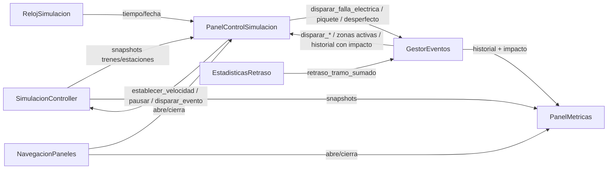

# Plan: HUD de control de simulación + eventos (Persona 2)

Aprobado con ajustes. Ejecutado de forma autónoma en `feature/hud-control-simulacion`
(desde `develop`), sin push ni merge. El resultado final, con qué quedó hecho y qué
pendiente, está en `docs/reporte_hud_control.md`.

Objetivo del proyecto a tener presente en cada decisión: **comparar el impacto de
distintos eventos**. Mantener todo simple, sin controles de más.

## 1. Relevamiento

- Resolución base 1280×720, sin `window/stretch/mode` configurado → UI en píxeles
  fijos, hay que anclar a bordes/esquinas, no asumir reescalado proporcional.
- HUD existente (`ui/screens/hud.tscn` + `hud.gd`): `CanvasLayer` con 3 paneles
  colapsables arriba-izquierda (Trenes, Pruebas de marcha, Switches, ~280px), más
  `Velocimetro` abajo-derecha. Zona libre: abajo-centro y el resto de la pantalla.
- Sin Theme (.tres) propio: estilo armado a mano con `StyleBoxFlat`. Paleta:
  panel `Color(0.10, 0.11, 0.15, 0.95-0.98)`, acento ámbar `Color(1.0, 0.756863,
  0.278431)`, texto `Color(0.65, 0.68, 0.75)`.
- El panel "Pruebas de marcha" existente llama métodos de `Tren` directo (deuda
  previa, documentada en `plan_para_lo_pendiente.md`). El HUD nuevo no repite ese
  patrón: sólo usa `SimulacionController`, `RelojSimulacion`, `EstadisticasRetraso`
  y `GestorEventos`.
- El snapshot de cada tren ya incluye `retraso_s` real. Los 3 colores de evento
  pedidos (amarillo/naranja/rojo) ya existen en `GestorEventos`. El marcador visual
  3D de eventos ya existe (`IndicadorEventos`).

## 2. Ajustes sobre el plan original

1. **Impacto por evento.** Cada entrada de la lista de eventos muestra cantidad de
   trenes afectados y retraso total generado (ej. "🟠 Piquete · Banfield · 2 trenes
   · +4 min"). Requiere atribuir el retraso de cada tramo al evento que lo causó —
   se agrega lo mínimo necesario en `GestorEventos` y `EstadisticasRetraso` (ver
   Arquitectura).
2. **Demora promedio** junto al estado de flota (calculada en el panel, promediando
   `retraso_s` de los trenes activos — no se depende de
   `obtener_resumen_global().demora_promedio_s`, que sigue neutro hasta que exista
   `EstadisticasSimulacion` de Persona 3).
3. **Teclas de debug → F1/F2/F3**, activas sólo en build de debug
   (`OS.is_debug_build()`) y nunca si hay un campo de texto con foco.
4. **Panel 2 (Métricas)** se implementa simple y de sólo lectura: tabla por tren
   (id, estado, retraso_s, estaciones recorridas) y tabla por evento (tipo,
   objetivo, trenes afectados, retraso total), con fila de totales arriba (demora
   promedio, incompletos). Preparado para que Persona 3 lo extienda.

## 3. Decisiones de diseño (resueltas)

| Decisión | Resuelto |
| --- | --- |
| Navegación | 3 botones redondos, abajo-centro |
| Ubicación del panel | Anclado abajo, se expande hacia arriba ("bottom sheet"), alto máximo + scroll interno |
| Formulario de eventos | Dropdown por nombre (tren/estación), sin selección por clic en el mapa |
| Estilo visual | Reusar la paleta actual (no Theme nuevo), con cuidado real de jerarquía visual — no placeholders sin trabajar |
| Feedback de eventos | Lista de texto con impacto (el marcador 3D ya existe aparte) |
| Conteo de flota por estado | Se calcula en el panel iterando `obtener_trenes()` |
| Slider de velocidad viejo | Se saca de "Pruebas de marcha", vive sólo en el panel nuevo |
| `obtener_zonas_activas()` / `nombre_tipo()` | Se agregan a `GestorEventos` |

## 4. Arquitectura

| Archivo | Responsabilidad |
| --- | --- |
| `ui/screens/navegacion_paneles.gd/.tscn` | 3 botones redondos + qué panel está abierto |
| `ui/screens/panel_control_simulacion.gd/.tscn` | Panel 1: reloj, flota, demora promedio, velocidad/pausa, formulario de eventos, feedback con impacto |
| `ui/screens/panel_metricas.gd/.tscn` | Panel 2: tablas de sólo lectura (tren, evento) + totales |
| `ui/screens/panel_reservado_placeholder.gd/.tscn` | Panel 3, "Próximamente" |

Cambios en módulos de Persona 5 (mínimos, documentados en `docs/eventos_ferroviarios.md`):

- `EstadisticasRetraso`: nueva señal `retraso_tramo_sumado(id_tren, aporte_s)`
  (emitida en cada llegada, incluso con aporte 0, para poder atribuir sin
  ambigüedad); nuevo `obtener_estaciones_recorridas(id_tren) -> int`.
- `GestorEventos`: cada evento disparado tiene un id único y acumula
  `trenes_afectados` (set) y `retraso_total_s`, sumado vía la señal nueva de
  `EstadisticasRetraso`. Nuevos `obtener_zonas_activas()` y `nombre_tipo(tipo)`.
  `obtener_historial()` devuelve ahora esos eventos enriquecidos (mismo shape de
  antes + los campos nuevos, no rompe a `IndicadorEventos`).

## 5. Etapas

Rama: `feature/hud-control-simulacion`. Un commit por etapa, sin avanzar con tests
en rojo.

| Etapa | Contenido |
| --- | --- |
| 0 | Backend: atribución de impacto por evento + estaciones recorridas + consultas nuevas. Test de atribución. |
| 1 | `NavegacionPaneles`: 3 botones + panel vacío que abre/cierra |
| 2 | Panel de control: reloj + flota + demora promedio + velocidad/pausa |
| 3 | Formulario de eventos + teclas F1/F2/F3 (debug-only, respeta foco de texto) |
| 4 | Feedback de eventos activos/historial con impacto |
| 5 | Panel de Métricas (tablas + totales) |
| 6 | Pulido visual + chequeo en ambas resoluciones + reporte final |

## 6. Verificación

Tests headless (`tools/test_*.gd`, Godot 4.7.2) por etapa, más chequeo visual
manual en 1280×720 y 1920×1080. Test específico pedido: que el retraso atribuido
a un evento coincida con el retraso real que sufrieron sus trenes.

## 7. Decisiones tomadas de forma autónoma

- **Etapas 2, 3 y 4 originales (reloj+flota, formulario de eventos, feedback)
  se consolidan en una sola "Etapa 2: Panel de control completo".** Las tres
  son parte de la misma escena/script (`panel_control_simulacion.gd`); separar
  los commits habría significado reescribir el mismo archivo tres veces sin
  una etapa intermedia verdaderamente usable por sí sola. Se probó y commiteó
  como una unidad.
- **Test de Etapa 0 (`test_atribucion_eventos.gd`) y el piquete de
  `test_indicador_eventos.gd` usan "Hipólito Yrigoyen" en vez de "Banfield".**
  Se encontró que con los 4 trenes iniciales convergiendo en la zona
  Lanús-Escalada-Banfield, el sistema de reservas de switches puede trabarlos
  sin que ninguno llegue nunca (fragilidad conocida de esa zona, documentada
  en `docs/integracion_switches_vias.md`, no relacionada a este HUD). Yrigoyen
  es la primera parada real y se alcanza rápido y de forma confiable.
- **Etapa 2 (Panel de control) y Etapa 5 (Panel de Métricas) se commitean
  juntas.** Ambas tocan `hud.tscn` en las mismas líneas (la fila de
  `ext_resource` y las propiedades de `NavegacionPaneles`), así que separar
  el commit habría significado editar ese archivo dos veces sin una etapa
  intermedia realmente independiente. Cada panel tiene su propio test y
  ambos están en verde antes del commit único.
- **Bug real encontrado y corregido durante el test de Etapa 2:**
  `PanelControlSimulacion._actualizar_feedback()` y
  `PanelMetricas._vaciar_filas()` vaciaban las filas viejas con
  `queue_free()` (borrado diferido al próximo frame) y agregaban las nuevas
  en la misma llamada síncrona -- dos generaciones de filas coexistían como
  hijas hasta que terminara el frame, así que una lectura inmediata después
  de refrescar podía encontrar datos viejos. Con el refresco periódico cada
  0.5s de uso normal esto es invisible (sobra tiempo entre refrescos para que
  el borrado diferido se procese), pero rompía toda refrescada inmediata
  (p.ej. justo después de disparar un evento desde el formulario). Corregido
  usando `free()` inmediato en ambos -- son Labels propios sin señales
  conectadas, así que es seguro.
- **`PanelControlSimulacion._resolver_nivel()` no depende de
  `get_tree().current_scene`.** Ese panel entra al árbol varios niveles por
  debajo de la raíz del nivel (HUD → NavegacionPaneles → panel), y
  `current_scene` puede no estar asignado todavía cuando eso pasa -- el mismo
  riesgo que ya documenta `hud.gd` en `_agregar_formacion`. Se resuelve
  subiendo por los ancestros hasta encontrar al que tiene `SimulacionController`
  como hijo. `PanelMetricas` usa el mismo mecanismo.
